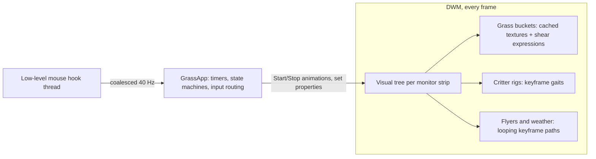

# DesktopGrassVersion2

A proof of concept that rebuilds [DesktopGrass](https://github.com/crutkas/DesktopGrass) on the Windows
Composition visual layer (`Windows.UI.Composition`) instead of an immediate-mode Direct2D renderer, with a
refreshed flat-vector look.

Everything on screen is a retained composition tree, and all motion (wind, gust springs, critter gaits,
butterfly flight paths, falling snow, palette crossfades) runs as keyframe and expression animations inside
DWM. The app process is event-driven: it wakes up for mouse input, state-machine timers and settings
changes, and otherwise does nothing.

## Run it

Requires Windows 10 2004+ and the .NET 10 Desktop Runtime.

```powershell
dotnet build src\DesktopGrass.Composition -c Release -r win-arm64   # or win-x64
src\DesktopGrass.Composition\bin\Release\net10.0-windows10.0.19041.0\win-arm64\DesktopGrass.Composition.exe
```

## Play

- **Move the mouse** through the grass to push it around; it springs back. Hover near an animal to see its name.
- **Click** the grass to cut a patch (clippings fly; it regrows in a minute or so); click a **mushroom** to make it boing.
- **Click near the animals**: sheep hop away, bunnies bolt, the hedgehog curls into a spiky ball, and the cat
  pounces on the spot (click the cat itself and it purrs).
- **Tray icon** (right-click): Scene, Motion (Full, or Calm which only reacts to you), Critters, Butterflies,
  fireflies and birds, Send a gust, Send birds, Pause, Quit. Double-click the icon to pause.

The overlay is click-through, sits above the taskbar on every monitor, and hides itself for fullscreen apps.
Calm motion is used automatically when Windows animations are off, on battery saver, or while the session is
locked. Settings are saved to `%LOCALAPPDATA%\DesktopGrass.Composition\state.json`.

## What's in it

| | |
| --- | --- |
| **Grass** | Filled, tapered gradient blades in 4 depth layers, flowers, mushrooms, a soft turf line. Ambient sway, mouse gusts with damped springs, cuts with flying clippings and staggered regrowth, mushroom boing. |
| **Critters** | Sheep (wander, graze, nap, frolic, greet each other with a heart), a cat in one of six coats (sits and watches, loafs for long naps, pounces at clicks, purrs when clicked), a bunny that only ever hops, and a hedgehog that snuffles and curls into a ball. Name tags on hover; Zzz when asleep. In Calm they doze and peek at you when you hover. |
| **Sky** | Butterflies (5 wing styles, flap-and-glide), blinking fireflies, and V-formation bird flocks (~15 per hour per monitor). |
| **Scenes** | Meadow; Desert (cacti, tumbleweeds); Winter (snow, snowy pines); Autumn (falling leaves, pumpkins); Ocean (bubbles, fish, coral). Switching scenes crossfades every color. Critters live in Meadow, Autumn and Winter. |

## How it works



- **One strip per monitor**: a layered, click-through, topmost window with a `DesktopWindowTarget`, holding
  ordered layers (back decor, back grass, critters, front grass, sky, effects).
- **Grass**: blades are `CompositionSpriteShape`s batched into ~30 DIP `ShapeVisual` groups, and groups are
  collected into ~140 DIP "buckets". Each bucket is rendered into a `CompositionVisualSurface` and shown on a
  `SpriteVisual`, so DWM rasterizes the vector blades only when they change. A shear about the ground line
  doesn't depend on x, so motion composes at two levels: ambient sway is one `TransformMatrix` expression per
  bucket sprite (attached only in Full motion), and a gust spring (`v`, `p`, `t` on the group's property set,
  timed by a shared clock) is attached to a group only while it is springing.
- **Critters** are one `ShapeVisual` rig each (groups for legs, head, ears, tail, eyes). Poses and gaits are
  keyframe loops; a walk is a single linear `Offset.X` animation. The app keeps a piecewise-linear x(t) mirror
  of each walk, so hover, clicks and sheep greetings (predicted meeting times) never need per-frame polling.
- **Flyers and weather** are fire-and-forget: a butterfly's whole life is a looping waypoint path plus a flap
  loop; snowflakes, leaves and bubbles are seamless cycles started at random phases.

## What the POC taught us

Measured on the dev box (ARM64; three monitors: 3270x2180 at 125% plus two 3840x2160 at 100%), cursor still,
20 s per case with `Get-Counter`, cases run back to back. CPU is percent of one core. Absolute numbers drift a
lot between sessions (one evening the original measured 24% and idle DWM 25%), so compare within a set.

| Case (same session) | App CPU | DWM CPU | DWM GPU 3D | App private MB |
| --- | ---: | ---: | ---: | ---: |
| Nothing running | – | 10–16% | 1–3% | – |
| Original DesktopGrass 0.1.0 (D2D, 24 fps) | 10.4% | 11.9% | 1.4% | 19 |
| POC, Full motion, cached grass (default) | 1.6% | 29% | 5.1% | 21 |
| POC, Full motion, live vector grass (`--no-cache`) | 1.0% | 56% | 11.4% | 18 |
| POC, Calm | 0% | 21% | 3.5% | 16 |
| POC, grass held still with butterflies and fireflies moving | 1.1% | 20% | 4.7% | 18 |

In Full motion the POC costs about what the original does in total (≈16% vs ≈11% of a core here), but the work
has moved from the app into DWM, and it animates at the display's refresh rate instead of 24 fps. Calm mode,
which still reacts to the mouse with full-rate springs, is close to free.

Lessons:

1. **The app gets ~10x cheaper, but the work moves into DWM.** Composition is not free; it is someone else's
   CPU.
2. **Attached expressions cost DWM every frame, even when nothing changes.** An earlier build with an
   expression per grass group (~2,500) kept a DWM core busy even in Calm. Detaching them at rest brought Calm
   back to baseline: the grass costs nothing until you touch it.
3. **DWM does not cache `ShapeVisual` vector content.** Anything moving nearby (even a few butterflies) makes
   DWM re-rasterize every vector shape in the dirty region, every frame: with ~6,000 blades that pegged a DWM
   core regardless of how few expressions there were. Rendering each ~140 DIP bucket into a
   `CompositionVisualSurface` (shown on a `SpriteVisual`, sway applied as a shear of the texture) cut DWM's
   added load in Full motion from +42% to +15% of a core.
4. **…but visual surfaces lose anti-aliasing.** DWM rasterizes visual-surface content at screen resolution
   with no anti-aliasing, and laying the source out at a higher scale made no difference, so blade edges
   stair-step and the thinnest tips break up. Pixel-snapping the sprites keeps it sharp, not smooth. The fix
   is to rasterize static art ourselves with Direct2D into `CompositionDrawingSurface`s and keep composition
   for motion.
5. **Closing a visual doesn't stop the animations on its shapes.** Disposing a visual closes its child visuals
   but not the `CompositionShape`s inside them, so infinite loops (wing flaps, gaits, blinks) kept running in
   DWM after the bird or critter was gone. Retired content is now closed shape by shape (`Shapes.Discard`).
6. **There's no frame-rate knob.** Composition animations run at the display refresh rate, so "how much
   moves" matters more than "how fast". Calm mode is the real power saver.
## Flags

`--scene <name>`, `--motion full|calm`, `--log` (writes `log.txt` next to the settings), `--demo` (scripted
gust, cut, boing, critter pokes and tray commands), `--birds-now`, `--no-hook`, `--no-settings`, `--seed <n>`,
`--exit-after <s>`, `--snapshot <png> --snapshot-after <s,s,...> --snapshot-strip <i>`.
Measurement knobs: `--no-cache` (live vector grass), `--no-critters`, `--no-sky`, `--no-sway` (no ambient sway or puffs), `--no-grass`,
`--bucket <dip>`, `--seg <dip>`, `--front-seg <dip>`, `--density <x>`.

## Next steps

- Rasterize grass, mushrooms and props with Direct2D into composition drawing surfaces (anti-aliased, still cheap).
- Measure on a single-monitor laptop, on battery.
- Try a C++/WinRT or NativeAOT build to shrink the managed working set.
- Cache critters and props the same way when they are at rest.
