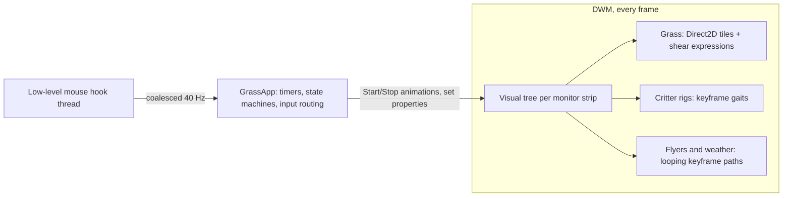

# DesktopGrassVersion2

A proof of concept that rebuilds [DesktopGrass](https://github.com/crutkas/DesktopGrass) on the Windows
Composition visual layer (`Windows.UI.Composition`) instead of an immediate-mode Direct2D renderer, with a
refreshed flat-vector look.

Everything on screen is a retained composition tree. Static art (the grass) is rasterized once with Direct2D
into composition textures, and all motion (wind, gust springs, critter gaits, butterfly flight paths, falling
snow) runs as keyframe and expression animations inside DWM. The app process is event-driven: it wakes up for
mouse input, state-machine timers and settings changes, and otherwise does nothing.

## Run it

Requires Windows 10 2004+ and the .NET 10 Desktop Runtime.

```powershell
dotnet build src\DesktopGrass.Composition -c Release -r win-arm64   # or win-x64
src\DesktopGrass.Composition\bin\Release\net10.0-windows10.0.19041.0\win-arm64\DesktopGrass.Composition.exe
```

## Play

- **Move the mouse** through the grass to push it around; it springs back. Hover near an animal to see its name.
- **Click** the grass to cut a patch (clippings fly; it regrows in a minute or so); click a **mushroom** to make it boing.
- **Click near the animals**: sheep hop away, bunnies bolt, raccoons scurry off, the hedgehog curls into a spiky
  ball, and the cat pounces on the spot. Click the cat itself and it purrs; poke a raccoon and it rears up on its
  hind legs first.
- **Tray icon** (right-click): Scene, Motion (Full, or Calm which only reacts to you), Critters, Butterflies,
  fireflies and birds, Send a gust, Send birds, Send the L train (City), Pause, Quit. Double-click the icon to pause.

The overlay is click-through, sits above the taskbar on every monitor, and hides itself for fullscreen apps.
Calm motion is used automatically when Windows animations are off, on battery saver, or while the session is
locked. Settings are saved to `%LOCALAPPDATA%\DesktopGrass.Composition\state.json`.

## What's in it

| | |
| --- | --- |
| **Grass** | Filled, tapered gradient blades in 4 depth layers, flowers, mushrooms, a soft turf line. Ambient sway, mouse gusts with damped springs, cuts with flying clippings and staggered regrowth, mushroom boing. |
| **Critters** | Sheep (wander, graze, nap, frolic, greet each other with a heart), a cat in one of six coats (sits and watches, loafs for long naps, pounces at clicks, purrs when clicked), a bunny that only ever hops, a hedgehog that snuffles and curls into a ball, and a gang of 2–3 raccoons that waddle, snuffle and rest. Every gang has exactly one Jimothy, who is shorter and rounder than the rest. Name tags on hover; Zzz when asleep. In Calm they doze and peek at you when you hover. |
| **Sky** | Butterflies (5 wing styles, flap-and-glide), blinking fireflies, and V-formation bird flocks (~15 per hour per monitor). |
| **Scenes** | Meadow; Desert (cacti, tumbleweeds); Winter (snow, snowy pines); Autumn (falling leaves, pumpkins); Ocean (bubbles, fish, coral); City (see below). Switching scenes sweeps the new palette across the grass. Critters live in Meadow, Autumn, Winter and the City. |
| **City** | New York meets Chicago: a skyline mixing the Empire State, Chrysler and One World Trade Center with the Willis Tower, John Hancock Center and Marina City, rooftop water towers and lit windows; the elevated L with stainless trains rumbling by; a Ferris wheel; and the Bean in a tulip-lined park. The cast is city folk: pigeon flocks that bob along and clatter off when startled, a bodega cat, and the raccoons (Jimothy included). |

## How it works



- **One strip per monitor**: a layered, click-through, topmost window with a `DesktopWindowTarget`, holding
  ordered layers (back decor, back grass, critters, front grass, sky, effects).
- **Grass**: blades are data. Each ~30 DIP group of blades is a `SpriteVisual` showing a tile that Direct2D
  rasterizes once, anti-aliased, into a `CompositionDrawingSurface` (snapped to whole device pixels). Groups
  are collected into ~140 DIP "buckets". A shear about the ground line doesn't depend on x, so motion composes
  at two levels without touching pixels: ambient sway is one `TransformMatrix` expression per bucket (attached
  only in Full motion), and a gust spring (`v`, `p`, `t` on the group's property set, timed by a shared clock)
  is attached to a group only while it is springing. The app redraws a tile only when its blades change: a
  cut, regrowth, a flower popping, or a new palette sweeping across the strip.
- **Critters** are one `ShapeVisual` rig each (groups for legs, head, ears, tail, eyes). Poses and gaits are
  keyframe loops; a walk is a single linear `Offset.X` animation. The app keeps a piecewise-linear x(t) mirror
  of each walk, so hover, clicks and sheep greetings (predicted meeting times) never need per-frame polling.
- **Flyers and weather** are fire-and-forget: a butterfly's whole life is a looping waypoint path plus a flap
  loop; snowflakes, leaves and bubbles are seamless cycles started at random phases.

## What the POC taught us

Measured on the dev box (ARM64) on its 3270x2180 display at 125%, cursor still, 20 s per case with
`Get-Counter`, all cases back to back. CPU is percent of one core.

| Case (same session, one monitor) | App CPU | DWM CPU | DWM GPU 3D | App private MB |
| --- | ---: | ---: | ---: | ---: |
| Nothing running | – | 13–15% | 1–2% | – |
| Original DesktopGrass 0.1.0 (D2D, 24 fps) | 10.9% | 13.9% | 1.7% | 19 |
| POC, Full motion, grass as live vector shapes ¹ | 1.6% | 54% | 10.8% | 18 |
| POC, Full motion, grass cached in visual surfaces ¹ | 1.5% | 29% | 5.7% | 21 |
| **POC, Full motion, grass as Direct2D tiles (current)** | 1.2% | 29% | 4.9% | 32 |
| **POC, Calm (current)** | 0.2% | 12.5% | 1.1% | 30 |
| Current, grass only (no critters or sky) | 0.7% | 21% | 2.5% | 29 |
| Current, grass held still, critters and sky moving | 0.9% | 27% | 8.7% | 30 |

¹ Earlier iterations, measured with the build at commit 970a291 (`--no-cache` selected live vector grass).

In Full motion the POC adds about 17% of a core (1% app, 16% DWM) where the original adds about 12% (11% app,
1% DWM), but it animates at the display refresh rate instead of 24 fps. Calm mode still reacts to the mouse
with full-rate springs and adds nothing measurable. With the two extra 3840x2160 monitors attached the same
pattern held at roughly twice the numbers (the original used 24% of a core; the live-vector build pinned a DWM
core).

Lessons:

1. **The app gets ~10x cheaper, but the work moves into DWM.** Composition is not free; it is someone else's
   CPU.
2. **Attached expressions cost DWM every frame, even when nothing changes.** An early build with an expression
   per grass group (~2,500) kept a DWM core busy even in Calm. Detaching them at rest brought Calm back to
   baseline: the grass costs nothing until you touch it.
3. **Keep vector shapes out of the frame loop.** DWM re-rasterizes `ShapeVisual` content in every dirty
   region, every frame. With the grass as live vector shapes, any motion nearby (sway, a butterfly) cost
   +41% of a DWM core; as textures, +16%.
4. **Rasterize textures yourself.** `CompositionVisualSurface` caches vector content cheaply but without
   anti-aliasing, so edges stair-step and thin blade tips break up. Direct2D tiles in
   `CompositionDrawingSurface`s cost the same and look as smooth as the live vectors. 1,500 blades rasterize in
   about 20 ms.
5. **What's left is the critters and flyers.** They are still live vector rigs, and with the grass held still
   they alone add ~14% of a DWM core. They are the next thing to move onto textures.
6. **Closing a visual doesn't stop the animations on its shapes.** Disposing a visual closes its child visuals
   but not the `CompositionShape`s inside them, so infinite loops (wing flaps, gaits, blinks) kept running in
   DWM after the bird or critter was gone. Retired content is now closed shape by shape (`Shapes.Discard`).
7. **There's no frame-rate knob.** Composition animations run at the display refresh rate, so "how much
   moves" matters more than "how fast". Calm mode is the real power saver.
## Flags

`--scene <name>`, `--motion full|calm`, `--log` (writes `log.txt` next to the settings), `--demo` (scripted
gust, cut, boing, critter pokes and tray commands), `--birds-now`, `--train-now`, `--no-hook`, `--no-settings`, `--seed <n>`,
`--exit-after <s>`, `--snapshot <png> --snapshot-after <s,s,...> --snapshot-strip <i>`.
Measurement knobs: `--no-critters`, `--no-sky`, `--no-sway` (no ambient sway or puffs), `--no-grass`,
`--bucket <dip>`, `--seg <dip>`, `--front-seg <dip>`, `--density <x>`.

## Next steps

- Move critters, flyers and props onto Direct2D textures too (rigs of textured parts).
- Measure on a single-monitor laptop, on battery.
- Try a C++/WinRT or NativeAOT build to shrink the managed working set.
- Cache critters and props the same way when they are at rest.
